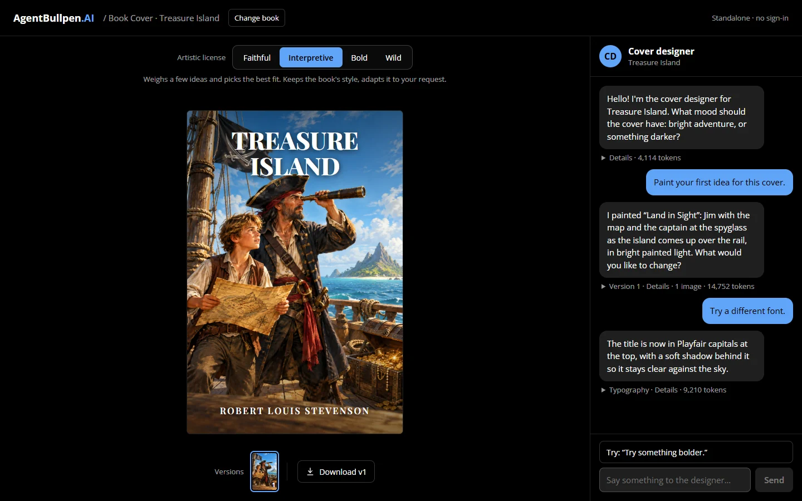

# AgentBullpen Cover Designer

Talk to a cover designer about a book and it paints the cover. A small call labels what each message asks for, and a [Microsoft Agent Framework](https://github.com/microsoft/agent-framework) agent gets only the tools for it: it brainstorms several concepts and paints the front-cover art, or changes the lettering without painting, and the app draws the title and author over the plate, on screen and in a print-size PNG you can download. An **artistic license** control sets how far each paint may move from the book's own look.



Three public-domain books are in (*The Hound of the Baskervilles*, *The Three Musketeers*, *Treasure Island*), or describe a book of your own.

**Docs:** [docs/README.md](docs/README.md), also served by the app at `/docs` — a [guide](docs/guide/) to running and configuring it, the [design](docs/design/) (how it works and why) and the [story](docs/story/).

## Quickstart

1. **Prerequisites:** .NET SDK 10 (`global.json`), Aspire CLI 13.6.0, Node.js 22 or later, and [uv](https://docs.astral.sh/uv/getting-started/installation/) with Python 3.13 or later.

2. **Set up a model** — only the designer needs one; the book list runs without it. Copy the `Llm` block from `src/CoverDesigner.AppHost/appsettings.json` into a new `src/CoverDesigner.AppHost/appsettings.Development.json` (gitignored) and fill it in:
   ```json
   {
     "Llm": {
       "Type": "OpenAI",
       "Model": "<model id, or the Azure deployment name>",
       "Endpoint": ""
     }
   }
   ```
   `Type` is `OpenAI` (OpenAI, Azure OpenAI with `https://<resource>/openai/v1/`, OpenRouter with `https://openrouter.ai/api/v1`) or `Anthropic`. Then store the key in the AppHost's user secrets, not the repo:
   ```
   aspire secret set Parameters:llm-api-key <your key>
   ```
   A coding agent follows [AGENTS.md](AGENTS.md) and never sees the key.

3. **Run it:** `aspire run`, then open the URL the dashboard shows for the **web** resource. The first run installs the api's and the web app's packages itself. If the browser doesn't trust the dashboard's certificate, run `dotnet dev-certs https --trust` once.

## Build and test

```
dotnet build
cd api && uv run pytest
cd web && npm ci && npm test && npm run build
```

## More

- **Images:** painting needs an OpenAI image model and its own key (the `Llm:Image` block and `Parameters:image-api-key`); without them the designer still talks. [Configuration](docs/guide/configuration.md).
- **Run behind a gateway:** the same build runs behind the [AgentBullpen.AI](https://agentbullpen.ai) site once `GATEWAY_SIGNING_KEY` and `VITE_API_BASE_URL` are set; standalone is the default. [Behind a gateway](docs/guide/gateway.md).
- **Deploying:** The api has a `Dockerfile` (`api/`); the web app is a static Vite build (`web/dist`). Host them however you like; no deployment pipeline ships with the repo.

## Contributing

This is a sample to clone or fork; it isn't accepting pull requests or issues.

## Licence

[MIT](LICENSE). Fonts and images: see [NOTICE](NOTICE.md).
