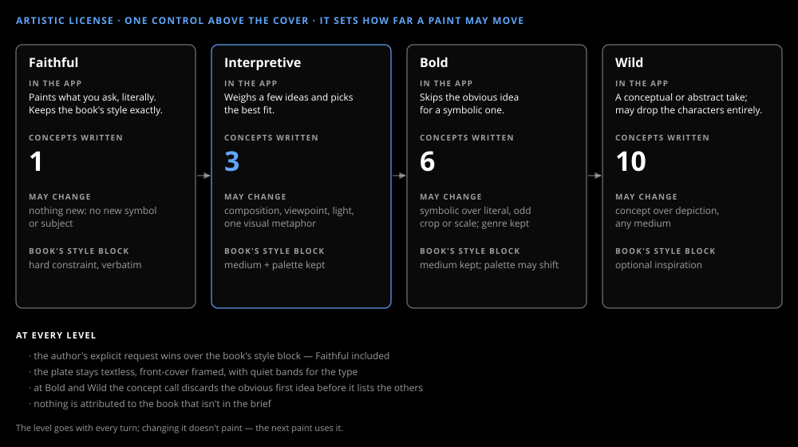

# Artistic license

_Design & research_

One control above the cover: how far the next paint may move from the book's own look. It changes how many ideas the concept call writes and how strongly the book's style block binds.

## Variety comes from choosing

Raising a model's temperature doesn't make a better cover. Writing several deliberately different concepts and choosing one does, so that is the lever: 1 concept at Faithful, 3 at Interpretive, 6 at Bold, 10 at Wild. At Bold and Wild the obvious first idea is discarded before the list is written. The levels and their rules come from the craft skill's table ([Cover craft](cover-craft.md)), which cites the research behind them.

## Why the brainstorm is in code

With a small chat model, asking the agent itself for more creativity produced plates that looked alike at every level. Moving the brainstorm into one structured-output call, with its own model (`LLM_CONCEPT_MODEL`, which can be a reasoning model), made the levels visibly different. The agent still decides *when* to paint and passes its notes; the concept call decides *what*.

## What never bends

At every level the author's request wins over the style block, the plate stays textless with quiet bands for the type, and nothing is attributed to the book that isn't in its brief. Changing the level doesn't paint; the next paint uses it.
