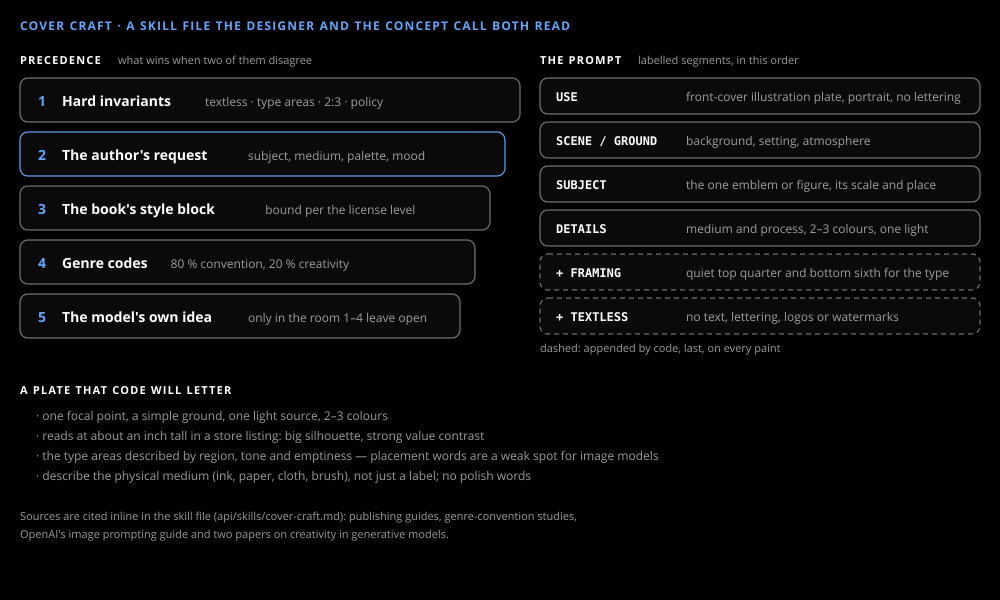

# Cover craft

_Design & research_

What a good cover needs is written down once, in `api/skills/cover-craft.md`, and both the designer and the concept call read it. Each rule in it cites its source inline or is marked as a design rule.

## Precedence

When two instructions disagree, the higher one wins: the hard invariants (textless, the reserved type areas, 2:3 portrait, content policy), then the author's request, then the book's style block at the strength the artistic license sets, then genre codes, then the model's own idea. The author outranking the style block is the rule that made the designer listen: a seeded style once kept the hound in every plate however the author asked.

## A plate that code will letter

One focal point, a simple ground, one light source, two or three colours, and a silhouette that still reads at an inch tall. The type areas are described by region, tone and emptiness, because placement words are a known weak spot for image models. Media are named physically — ink, paper, cloth, brush — not by label.

## The prompt

Labelled segments in OpenAI's recommended order: USE, SCENE/GROUND, SUBJECT, DETAILS. The concept call writes those four; code appends the front-cover framing and the no-text rule last, on every paint, so no prompt can drop them.

## Style blocks

`api/styles/` holds one block per demo book and one per preset (animated, cinematic, classic, minimal, painted). A block names motifs, a medium and a palette — never a fixed subject — so the author can still ask for anything.
