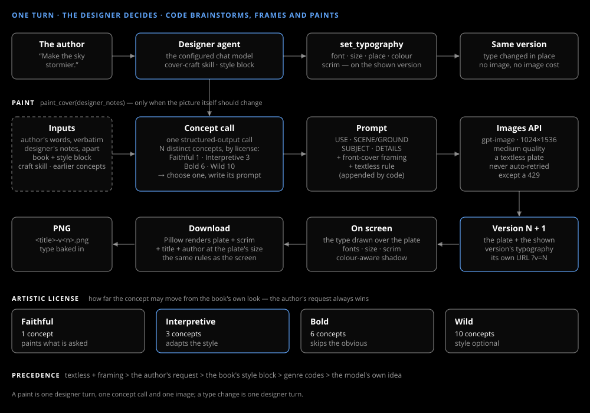

# The designer

_Design & research_

One agent with two tools. Code labels each message and gives the agent only the tools that label allows; code also brainstorms, frames, paints and checks the contrast.

## Intent first

Before the agent runs, one small structured call on the chat model labels the author's message: `type`, `picture`, `both` or `talk`. A type request gets no paint tool, so it cannot paint; talk gets none. If the call fails, the turn runs with both.

## Two tools

`paint_cover` when the picture itself should change. `set_typography` for the font, title size and place, alignment, capitals, author line, colour and the shadow behind the text. It makes a new version of the cover on screen: the same plate with the type changed, and no image. After it, and after every paint, code measures how the type reads on the plate and fixes the colour or the scrim if it reads badly ([Typography and download](typography.md#legibility)).

## Concepts before a prompt

Before every paint, one structured-output call lists distinct concepts, chooses one and writes its prompt in a fixed labelled order: USE, SCENE/GROUND, SUBJECT, DETAILS. The artistic license sets how many: one at Faithful, ten at Wild. The author's latest message goes in word for word and the designer's notes separately, so the agent can't rewrite what was asked.

## What code adds

Front-cover framing and a no-text rule are appended last, so the plate never carries lettering. The app draws the title and author, on screen and in the PNG, by the same rules.

> **Precedence** — the author's request beats the book's style block at every license level, Faithful included.
