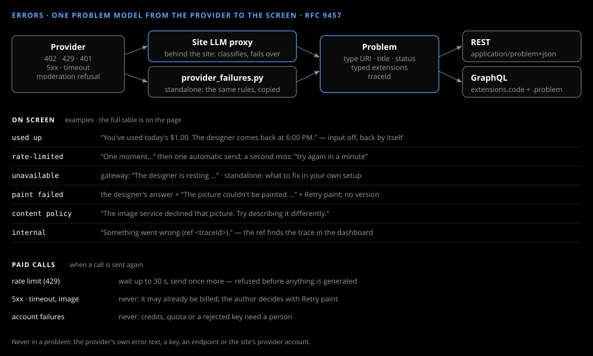

# Errors

_Design & research_

Every failure is one [RFC 9457](https://www.rfc-editor.org/rfc/rfc9457) problem, from the provider to the screen, with one state for each kind.

## One problem model

A problem has a type URI (the AgentBullpen.AI site's, `https://agentbullpen.ai/problems/<slug>`), a title, a status, typed extensions and the trace id. REST answers carry it as `application/problem+json`; GraphQL errors keep their `extensions.code` and add `extensions.problem`. A problem never carries the provider's own text, a key or an endpoint.

## Who classifies

Behind the site, its LLM proxy classifies the provider's failure, fails over where it can and tells the site's owner. Standalone there is no one else to tell, so the API applies the same rules itself and the message says what to fix in your own setup — top up credits, switch provider, or set the key again.

## What the author sees

| Problem | On screen |
|---|---|
| allowance used up | "You've used today's $1.00. The designer comes back at {time}." — input off, back by itself |
| rate limited | "One moment…", one automatic send, then "try again in a minute" |
| provider unavailable | behind the site "The designer is resting…", standalone the fix-it text; Try again |
| the paint failed | the designer's answer and a note under it, with **Retry paint** when trying again could help; no version is added |
| content policy | "The image service declined that picture. Try describing it differently." |
| signed out | the site's sign-in page, back to this page afterwards |
| the designer off | "The designer isn't turned on for your account yet." — input off |
| an unexpected error | "Something went wrong (ref {traceId})." — the ref finds the trace |

A book that won't open shows the same reasons on the pick screen, with Try again.

## Paid calls

An image is never sent twice after an error or a timeout: it may already be billed, so the author decides with Retry paint. Only a rate limit, refused before anything is generated, is retried once, after at most 30 seconds.
