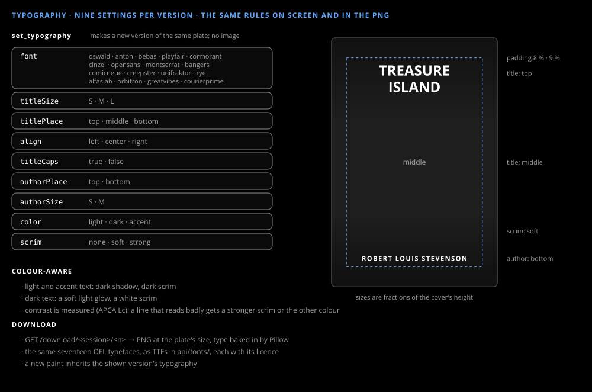

# Typography and download

_Design & research_

The plate is textless; the type is the app's. Nine settings live on each version, and the screen and the downloaded PNG draw them by the same rules. A type change is a new version of the same plate.

## Nine settings

`font` (one of the seventeen faces below), `titleSize`, `titlePlace`, `align`, `titleCaps`, `authorPlace`, `authorSize`, `color` and `scrim`, the shadow gradient behind the text. A new paint inherits the settings of the version on screen.

## A type change is a version

`set_typography` never edits a version. It adds one: the plate of the version on screen, with the settings changed, and no image call. The strip under the cover shows each version with its type, so two type versions of one plate can be told apart, and going back to an earlier version shows its type as it was. A version says what it is (`kind`: `paint` or `type`) and which version it was made from (`from`). A turn makes at most one version: a type change in the same turn as a paint goes on the version just painted.

## One set of rules, two renderers

Sizes are fractions of the cover's height and padding of its width, so the browser's overlay and Pillow's render at the plate's full size agree. Light and accent text get a dark shadow and a dark scrim; dark text gets a soft light glow and a white scrim, so it doesn't look embossed.

## Titles always fit

No glyph leaves the padded box. The title wraps at word boundaries. When its longest word is wider than the box, or the wrapped lines are taller than the room the author line leaves, the title is set smaller, 5% at a time, down to 60% of the setting's size. Under that the letter-spacing tightens, to −0.05 em at most, and only if the word still doesn't fit does it break. The author line follows the same rule. A line is measured by its ink, so an `f` or a script's swash that overhangs counts, and such a line is moved just far enough to stay inside. The text is never squeezed sideways and never spaced out to fill the box.

The browser and Pillow run the same steps, each with its own measurements (`web/src/coverFit.ts`, `api/typography.py`).

## Download

`GET /download/<session>/<n>` returns the version as a PNG with the type baked in, named after the title and version. It is a plain GET so it works through the site's gateway with the member's cookie.

## Fonts

A font is asked for in the author's words and set from a library of seventeen faces, all under the SIL Open Font License:

| id | Typeface | What it is for |
|---|---|---|
| `oswald` | Oswald | condensed sans |
| `anton` | Anton | poster, Impact-like |
| `bebas` | Bebas Neue | tall capitals |
| `playfair` | Playfair Display | classic serif |
| `cormorant` | Cormorant Garamond | old-style serif |
| `cinzel` | Cinzel | inscriptional capitals |
| `opensans` | Open Sans | plain sans |
| `montserrat` | Montserrat | geometric sans |
| `bangers` | Bangers | comic book |
| `comicneue` | Comic Neue | hand-lettered comic, Comic Sans-like |
| `creepster` | Creepster | horror |
| `unifraktur` | UnifrakturMaguntia | blackletter, gothic |
| `rye` | Rye | western |
| `alfaslab` | Alfa Slab One | slab serif |
| `orbitron` | Orbitron | sci-fi |
| `greatvibes` | Great Vibes | script, romance |
| `courierprime` | Courier Prime | typewriter, noir |

The designer picks the closest face for what was asked, and the author's words are kept with it: Details shows `font Bangers · asked “comic book”`. A typeface that isn't in the library, such as Comic Sans, can't be set. The closest face is set in its place, the designer says so, and Details adds `substituted: not an open font here`. For well-known names the stand-in is fixed in code, whatever face the designer picked:

| Asked for | Set |
|---|---|
| Comic Sans | Comic Neue |
| Futura, Avant Garde, Gotham | Montserrat |
| Impact | Anton |
| Helvetica, Arial | Open Sans |
| Times New Roman, Garamond, Caslon | Cormorant Garamond |
| Bodoni, Didot | Playfair Display |
| Trajan | Cinzel |
| Courier | Courier Prime |
| Franklin Gothic, DIN | Oswald |

For any other name the designer's own choice stands.

The author line is in capitals, tracked out, except in Great Vibes and UnifrakturMaguntia, where it is set as typed: script and blackletter capitals aren't made to stand in a row. For the same reason the title is never in capitals in those two faces: switching to one of them turns `titleCaps` off.

The web app loads a face from Fontsource when a cover first uses it; the API carries the TTFs in `api/fonts/`, each family with its `OFL.txt`.

## Legibility

After every type change and every paint, the API measures how the title and the author line read on the plate, and fixes the type when they don't. No model is asked, so the answer is the same every time.

The measure is [APCA](https://github.com/Myndex/apca-w3) lightness contrast (Lc), from the published `apca-w3` 0.1.9. It is taken at each pixel of a line's ink against what is under it: the plate with the scrim over it. The text's shadow doesn't count as ink. A line passes when the median, and all but the worst 5% of its ink, reach Lc 45, APCA's minimum for large, heavy text. It fails when the median is under 45, and gets a warning when only a patch is.

When a line doesn't pass, code tries the scrim a step stronger at a time, then the other text colour with each scrim from the current one up, and keeps the first choice on which both lines pass. It changes nothing else. A colour or scrim the author asked for in that same message stays as asked: only the other one may move, and if the line still reads badly the designer says so. Details shows the result, for example `Legibility: title Lc 78 · author Lc 64 · scrim raised to strong`.
