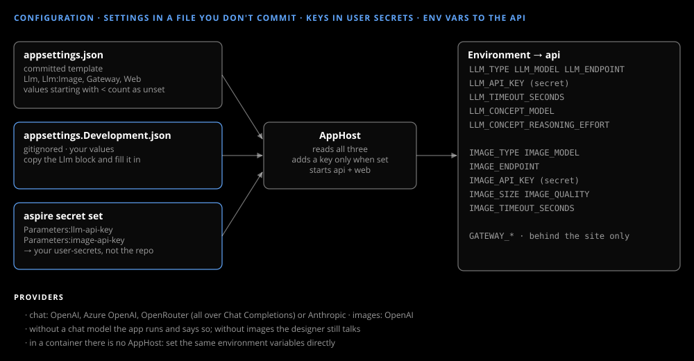

# Configuration

_Guide_

Settings go in a file you don't commit, keys in your user secrets; the AppHost turns both into environment variables for the API.



## Chat model

| Variable | Meaning |
|---|---|
| `LLM_TYPE` | `OpenAI` (OpenAI, Azure OpenAI, OpenRouter) or `Anthropic` |
| `LLM_MODEL` | the model id, or the Azure deployment name |
| `LLM_ENDPOINT` | `OpenAI` type only: empty = api.openai.com; `https://openrouter.ai/api/v1`; Azure `https://<resource>/openai/v1/` |
| `LLM_API_KEY` | secret: `aspire secret set Parameters:llm-api-key <key>` |
| `LLM_TIMEOUT_SECONDS` | per call, default 60 |
| `LLM_CONCEPT_MODEL` | optional: the model for the concept call before each paint; empty = `LLM_MODEL` |
| `LLM_CONCEPT_REASONING_EFFORT` | optional, `OpenAI` type: e.g. `low`, `medium` |

From the `Llm` block of `appsettings.Development.json`. Every `OpenAI`-type provider is called over Chat Completions; the API keeps each session's conversation itself.

## Images

| Variable | Meaning |
|---|---|
| `IMAGE_TYPE` | `OpenAI` (the only image provider in this build) |
| `IMAGE_MODEL` | e.g. `gpt-image-2.5-flare` |
| `IMAGE_ENDPOINT` | optional: empty = api.openai.com |
| `IMAGE_API_KEY` | secret: `aspire secret set Parameters:image-api-key <key>` |
| `IMAGE_SIZE` | default `1024x1536` (portrait, about 2:3) |
| `IMAGE_QUALITY` | default `medium` |
| `IMAGE_TIMEOUT_SECONDS` | default 120 |

From the `Llm:Image` block.

## Check

```
{ availability { chat chatNote images imagesNote } }
```

names whatever is missing. A value that still starts with `<` counts as unset.

## Without the AppHost

In a container, set the same environment variables directly. The gateway's settings are on [Behind a gateway](gateway.md).
