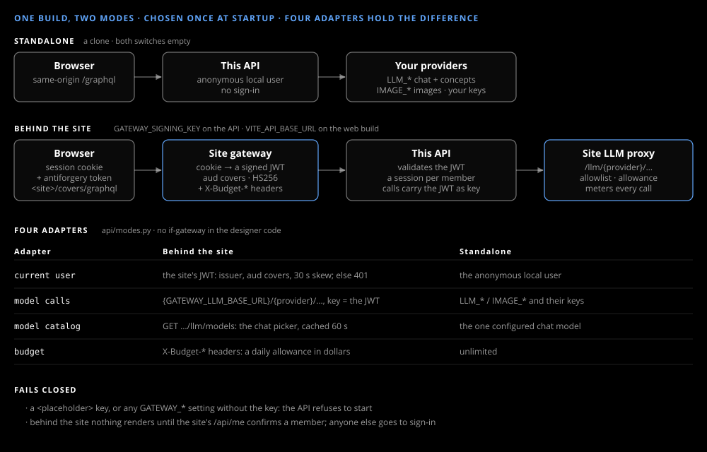

# Behind a gateway

_Guide_

The same build runs behind the [AgentBullpen.AI](https://agentbullpen.ai) site, which signs members in and pays for their model calls. Standalone needs none of this page.

## Two switches

| Side | Switch | AppHost config |
|---|---|---|
| API | `GATEWAY_SIGNING_KEY` (secret) | `Auth:Gateway:SigningKey` or the parameter `gateway-signing-key` |
| Web build | `VITE_API_BASE_URL` | `Web:ApiBaseUrl` |

Both empty is standalone.

## The rest

| Variable | Default |
|---|---|
| `GATEWAY_ISSUER` | `https://api.agentbullpen.ai` |
| `GATEWAY_AUDIENCE` | `covers` |
| `GATEWAY_LLM_BASE_URL` | `https://api.agentbullpen.ai/llm` |
| `GATEWAY_CHAT_MODEL` | `openai:gpt-4o-mini` (`provider:model`) |
| `GATEWAY_CONCEPT_MODEL` | `openai:gpt-6-luna` |
| `GATEWAY_IMAGE_MODEL` | `openrouter:openai/gpt-image-2.5-flare` |
| `VITE_SITE_URL` (`Web:SiteUrl`) | the site: sign-in, the wordmark's link, the user menu |

The API refuses to start when the key is still a `<placeholder>`, or empty while any other `GATEWAY_*` setting is set. `IMAGE_SIZE`, `IMAGE_QUALITY` and the timeouts still apply; the `LLM_*` and `IMAGE_*` keys are not used.

## What changes

- **Sign-in:** nothing renders until the site confirms a member; anyone else goes to its sign-in page. A session belongs to its member.
- **Model calls:** each keeps the provider's own path with the host replaced by `{GATEWAY_LLM_BASE_URL}/{provider}`, the request's token as the key and `X-Conversation-Id: <session>`. The image model's provider picks its protocol: `openrouter:` posts to `/llm/openrouter/v1/images`, `openai:` and `azure:` use OpenAI's Images API.
- **Allowance:** a daily amount in dollars under the input, and each turn's cost in its Details line.
- **Model picker:** in the chat header when the site lists more than one chat model; switching keeps the session and its versions.

The site's side of this contract — the route, the proxy, the allowlist, the allowances — belongs to the site. Why it is built this way: [Models and gateway](../design/models.md).
