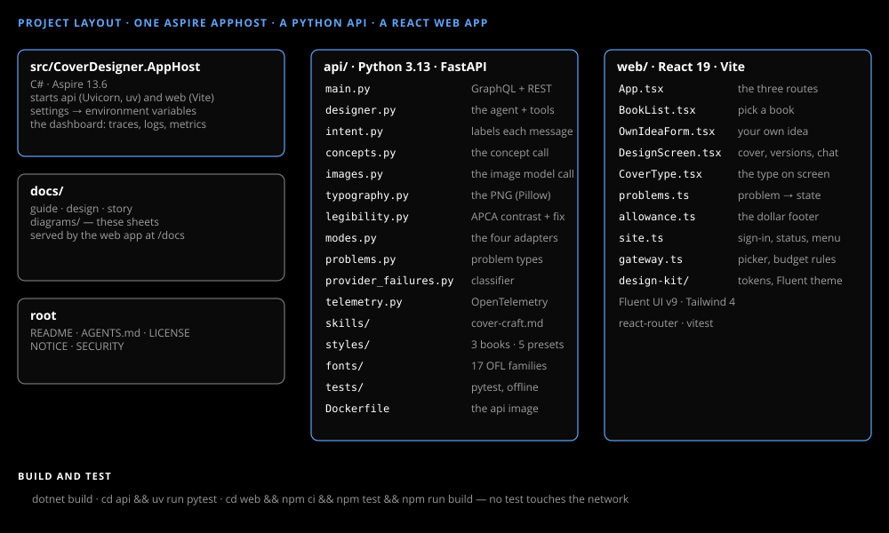

# Project layout

_Guide_

One Aspire AppHost, a Python API and a React web app; nothing shared with any other repo.



## The API

FastAPI under Uvicorn, Strawberry for GraphQL, Microsoft Agent Framework for the designer, Pillow for the PNG. `uv` syncs it when `aspire run` starts. `intent.py` labels each message, `legibility.py` measures and fixes the type's contrast, and `api/Dockerfile` builds the API as a container image. The designer's knowledge is in two folders: `skills/cover-craft.md` ([Cover craft](../design/cover-craft.md)) and `styles/`, a style block per demo book and preset.

## The web app

React 19 on Vite, Fluent UI v9 with the site's design kit (`web/src/design-kit/`), Tailwind 4 and react-router. Behind a gateway it adds the site's sign-in check and user menu (`site.ts`); standalone it makes no call to any site.

## Build and test

```
dotnet build
cd api && uv run pytest
cd web && npm ci && npm test && npm run build
```

No test touches the network.

## Editing the API on Windows

Uvicorn's reload can take minutes to pick up a change on Windows. `aspire stop`, then `aspire run`, is faster.
