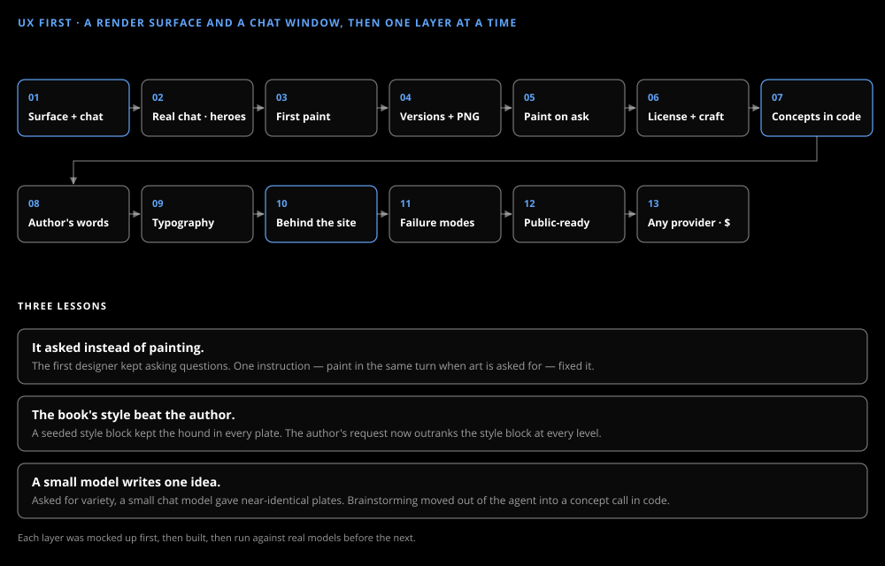

# UX first

_The story_

The app was built screen first: a render surface and a chat window with nothing behind them, then one layer at a time, each mocked up, built and run against real models before the next.

## The order

After the book list, a static surface and chat came first, then a real designer and the book heroes, the first painting, versions with their own URLs and the download. The craft came next — the artistic license, the craft skill, concepts in code, the author's words passed through untouched — then the typography tool, and last the work that lets it run behind the AgentBullpen.AI site: the gateway, failure modes, sign-in, a dollar allowance and any OpenAI-compatible provider.

## Four things that changed the design

**It asked instead of painting.** The first designer answered "paint the cover" with questions. One instruction — paint in the same turn when art is asked for — fixed it.

**The book's style beat the author.** A seeded style block put the hound in every plate, however the author asked. The author's request now outranks the style block at every level, and style blocks name motifs, never a fixed subject.

**A small model writes one idea.** Asked for variety, a small chat model gave near-identical plates at every level. The brainstorm moved out of the agent into a structured-output concept call with its own model, and the levels came apart.

**A model that never sees the cover can't judge it — and a small one that does can't either.** Contrast is measured instead.
